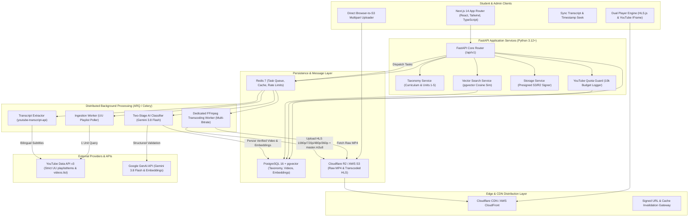
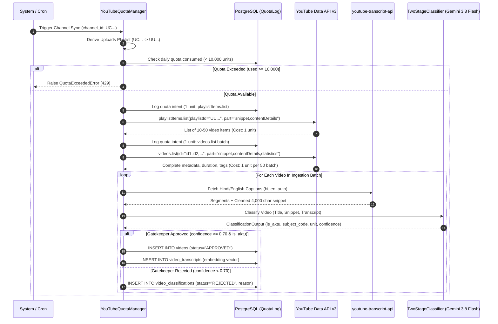
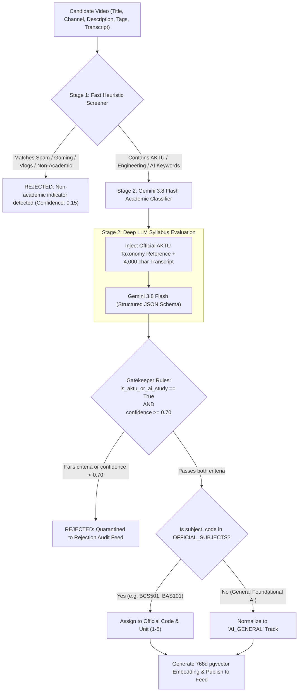
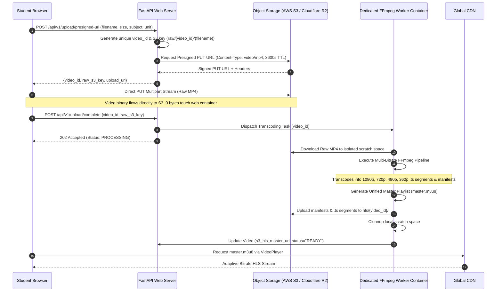
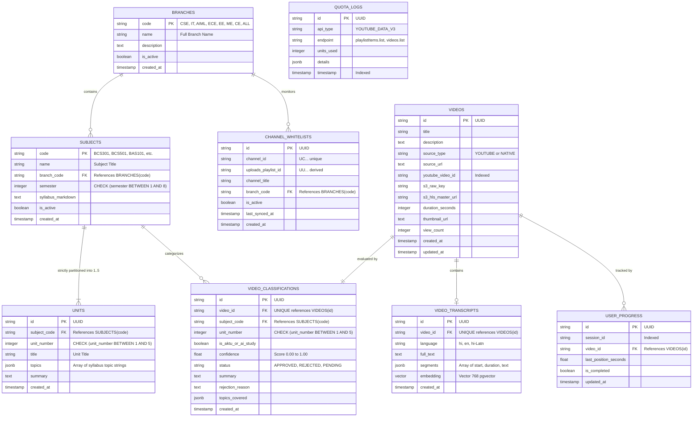
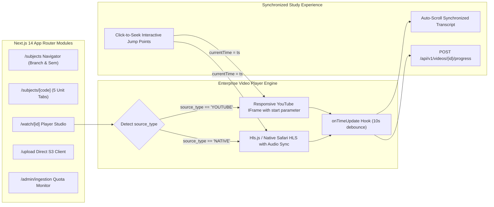

# System Architecture & Technical Flow — AKTU Stream AI

## 1. High-Level Architecture Flow



---

## 2. Ingestion Pipeline & Strict Quota Budgeting Flow

To eliminate YouTube Data API quota exhaustion (where `search.list` burns 100 quota units per call with a 10,000 units/day limit), **AKTU Stream AI operates on a strictly enforced zero-search architecture**:



### Quota Math Comparison
- **Standard Search Approach**: 100 calls = $100 \times 100 = 10,000\text{ units}$ (Quota exhausted in 100 queries).
- **AKTU Stream AI Zero-Search Engine**:
  - `playlistItems.list`: **1 unit** per 50 videos.
  - `videos.list` (Batch of 50): **1 unit**.
  - Total cost for 50 videos: **2 quota units** ($99.98\%$ reduction).
  - Daily capacity under 10k quota: **up to 250,000 indexed videos per day**.

---

## 3. Two-Stage Content Gatekeeping & Verification Pipeline

Every lecture—whether scraped from YouTube or uploaded natively by a student—must clear the Two-Stage Academic Gatekeeper:



### Structured Output Contract (`ClassificationOutput`)
```json
{
  "is_aktu_or_ai_study": true,
  "subject_code": "BCS501",
  "unit_number": 2,
  "confidence": 0.96,
  "summary": "Covers relational algebra, tuple relational calculus, and SQL join queries for AKTU Unit 2 DBMS.",
  "rejection_reason": null,
  "topics_covered": [
    "Relational Algebra",
    "Tuple Relational Calculus",
    "SQL Joins",
    "Integrity Constraints"
  ]
}
```

---

## 4. Storage & FFmpeg Multi-Bitrate HLS Transcoding Architecture

Web server memory must never be exhausted by multi-gigabyte video uploads. All native student video files stream directly to S3/Cloudflare R2 via presigned URLs, and transcoding runs asynchronously in a dedicated worker container:



### Multi-Bitrate Output Specifications
| Stream Profile | Resolution | Video Bitrate | Audio Bitrate | Target Bandwidth | Playlist Manifest |
| :--- | :--- | :--- | :--- | :--- | :--- |
| **1080p High** | $1920 \times 1080$ | 5,000 kbps | 192 kbps | 5,192,000 bps | `stream_0.m3u8` |
| **720p Standard**| $1280 \times 720$ | 2,800 kbps | 128 kbps | 2,928,000 bps | `stream_1.m3u8` |
| **480p Balanced**| $854 \times 480$ | 1,400 kbps | 128 kbps | 1,528,000 bps | `stream_2.m3u8` |
| **360p Mobile**  | $640 \times 360$ | 800 kbps | 96 kbps | 896,000 bps | `stream_3.m3u8` |
| **Master Index** | Adaptive Multi | VBR | AAC-LC | Dynamic | `master.m3u8` |

---

## 5. Database Schema & Relational Constraint Architecture

The PostgreSQL 16 schema enforces strict referential integrity down to unit intervals ($1 \le \text{unit\_number} \le 5$):



---

## 6. Frontend Architecture & Dual Playback Engine

Built with Next.js 14 App Router, TypeScript strict mode, and Tailwind CSS. The player provides an abstraction layer switching seamlessly between YouTube embeds and native multi-bitrate HLS streaming:



---

## 7. Observability, Security, & Non-Functional Resilience

1. **Sub-100ms API Response Latency**:
   - Static AKTU syllabus trees and unit definitions are indexed with composite indices `(subject_code, unit_number)` and cached in memory.
2. **Sub-300ms Semantic Search**:
   - Fast semantic retrieval uses `pgvector` HNSW / IVFFlat indexing across 768-dimensional embeddings generated from transcript segments.
3. **Transient Failure Handling**:
   - YouTube Data API and Google GenAI API clients implement exponential backoff with jitter on HTTP `429` / `503` responses.
4. **Permanent Zero-Search Guard**:
   - The method `verify_and_log_quota()` intercepts any call containing `"search"` and immediately raises a `PermissionError`, ensuring unauthorized search queries are halted before contacting Google Cloud endpoints.
