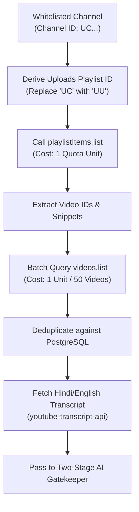
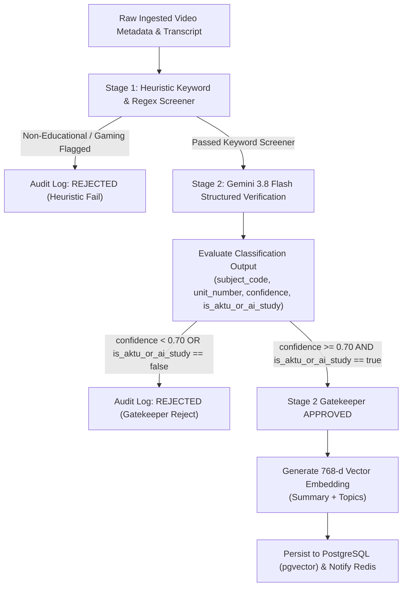
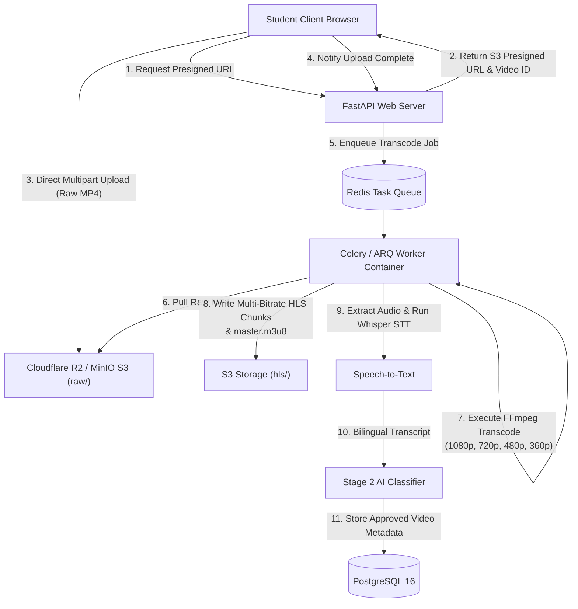
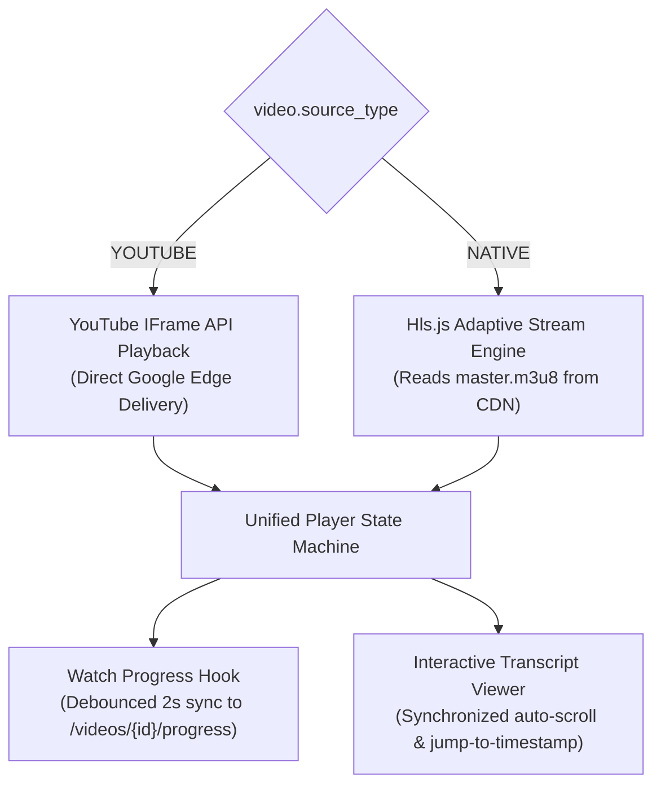
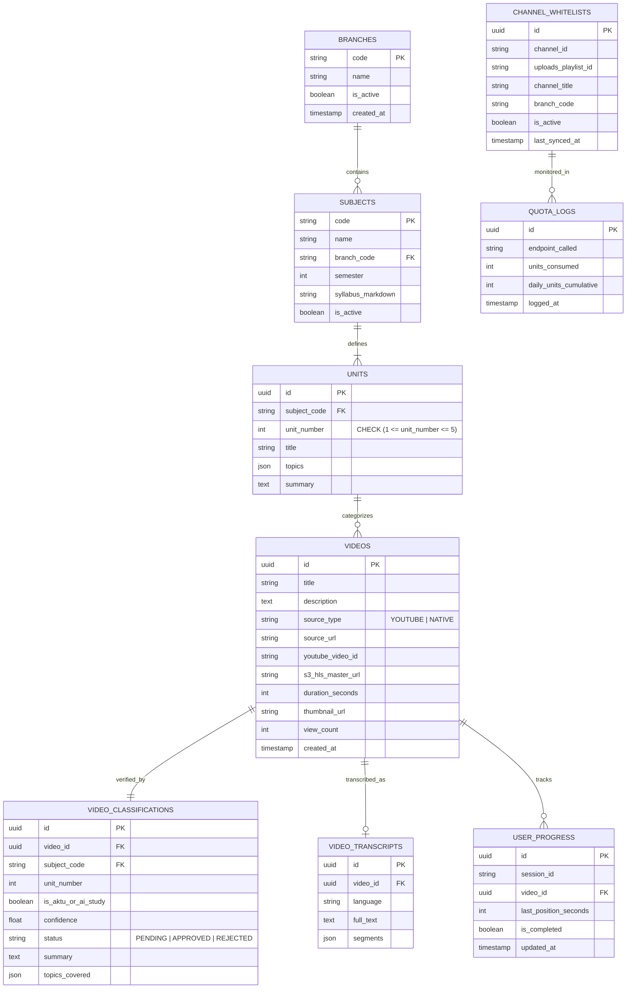

# System Architecture & Flow — AKTU Stream AI

## 1. Executive Architecture Overview

AKTU Stream AI is an enterprise-grade, quota-conscious educational streaming and search platform dedicated to Dr. A.P.J. Abdul Kalam Technical University (AKTU) engineering students and AI/ML learners.

The platform enforces five non-negotiable architectural invariant rules:
1. **Strict YouTube Quota Budgeting (Zero `search.list`)**: `search.list` calls cost 100 quota units each and exhaust the 10,000 unit daily limit in 100 queries. Instead, the platform derives upload playlists (`UU...` from `UC...`) and polls `playlistItems.list` (1 unit/call) and batched `videos.list` (1 unit per 50 videos).
2. **Two-Stage AI Content Gatekeeper**: All prospective videos pass through Stage 1 heuristic pre-filtering and Stage 2 Gemini 3.8 Flash structured verification (`ClassificationOutput`). Videos with `confidence < 0.70` or `is_aktu_or_ai_study == False` are rejected and recorded in the audit log.
3. **Modular Storage Abstraction & Direct S3 Presigned Uploads**: Web server containers never buffer or process raw video files. Client browsers upload directly to S3/R2 presigned URLs. Asynchronous FFmpeg workers transcode raw video into 1080p, 720p, 480p, and 360p multi-bitrate HLS streams, writing a master `.m3u8` playlist.
4. **Schema Strictness**: Syllabus units are strictly constrained to intervals $1 \le \text{unit\_number} \le 5$, with uniqueness enforced on `(subject_code, unit_number)`.
5. **Zero Hallucination Taxonomy**: Subject codes must match official university codes (`BCS301`, `BCS501`, `BAS101`, `BEE301`, etc.) or the reserved track tag `AI_GENERAL`.

---

## 2. High-Level Architecture Flow Diagrams

### 2.1. Quota-Conscious Ingestion Pipeline



### 2.2. Two-Stage AI Content Gatekeeper



### 2.3. Native Student MP4 Direct Upload & HLS Transcoding Pipeline



### 2.4. Dual Playback Engine Architecture



---

## 3. Database Entity Relationship Diagram



---

## 4. Directory & File Structure

```text
aktu-stream-ai/
├── docker-compose.yml
├── .env.example
├── README.md
├── PRD.md
├── ARCHITECTURE.md
├── backend/
│   ├── Dockerfile
│   ├── requirements.txt
│   ├── pyproject.toml
│   ├── app/
│   │   ├── main.py
│   │   ├── core/
│   │   │   ├── config.py
│   │   │   ├── database.py
│   │   │   └── redis.py
│   │   ├── models/
│   │   │   ├── __init__.py
│   │   │   ├── models.py
│   │   │   ├── subject.py
│   │   │   ├── video.py
│   │   │   └── user_progress.py
│   │   ├── schemas/
│   │   │   ├── __init__.py
│   │   │   ├── classification.py
│   │   │   ├── subject.py
│   │   │   └── video.py
│   │   ├── services/
│   │   │   ├── classifier.py
│   │   │   ├── classifier_service.py
│   │   │   ├── youtube.py
│   │   │   ├── youtube_service.py
│   │   │   ├── storage.py
│   │   │   ├── storage_service.py
│   │   │   ├── transcoder_service.py
│   │   │   ├── taxonomy_service.py
│   │   │   ├── transcript_service.py
│   │   │   └── vector_search.py
│   │   ├── workers/
│   │   │   ├── celery_app.py
│   │   │   ├── tasks_ingest.py
│   │   │   ├── tasks_transcode.py
│   │   │   └── tasks.py
│   │   └── api/
│   │       └── v1/
│   │           ├── router.py
│   │           ├── api.py
│   │           └── endpoints/
│   │               ├── subjects.py
│   │               ├── videos.py
│   │               ├── search.py
│   │               └── submissions.py
│   └── tests/
│       ├── conftest.py
│       ├── test_api.py
│       ├── test_classifier.py
│       ├── test_schema_constraints.py
│       ├── test_storage_hls.py
│       └── test_youtube_quota.py
└── frontend/
    ├── Dockerfile
    ├── package.json
    ├── tsconfig.json
    ├── tailwind.config.ts
    ├── next.config.ts
    └── src/
        ├── app/
        │   ├── globals.css
        │   ├── layout.tsx
        │   ├── page.tsx
        │   ├── admin/
        │   │   └── ingestion/
        │   │       └── page.tsx
        │   ├── ai-track/
        │   │   └── page.tsx
        │   ├── branch/
        │   │   └── [branchId]/
        │   │       └── [semId]/
        │   │           └── [subjectCode]/
        │   │               └── page.tsx
        │   ├── search/
        │   │   └── page.tsx
        │   ├── subjects/
        │   │   ├── page.tsx
        │   │   └── [code]/
        │   │       └── page.tsx
        │   ├── upload/
        │   │   └── page.tsx
        │   └── watch/
        │       └── [videoId]/
        │           └── page.tsx
        ├── components/
        │   ├── layout/
        │   │   ├── Header.tsx
        │   │   ├── Navbar.tsx
        │   │   └── SidebarNav.tsx
        │   ├── player/
        │   │   ├── UnifiedPlayer.tsx
        │   │   ├── TranscriptViewer.tsx
        │   │   └── VideoPlayer.tsx
        │   ├── syllabus/
        │   │   ├── UnitTabs.tsx
        │   │   └── VideoCard.tsx
        │   └── video/
        │       └── VideoCard.tsx
        ├── hooks/
        │   ├── useWatchProgress.ts
        │   └── useSyllabusTree.ts
        ├── lib/
        │   ├── api-client.ts
        │   ├── api.ts
        │   ├── types.ts
        │   └── utils.ts
        └── types/
            ├── index.ts
            └── syllabus.ts
```

---

## 5. Technology Stack & Runtime Specifications

| Layer | Component | Specification |
| :--- | :--- | :--- |
| **Frontend** | Framework | Next.js 14 (App Router, Server & Client Components) |
| | Language | TypeScript 5.6 (strict mode) |
| | Styling & Icons | Tailwind CSS 3.4, Lucide React |
| | Video Playback | Hls.js 1.5 (Adaptive streaming) + YouTube IFrame API |
| **Backend** | Framework | FastAPI (Python 3.12+, async endpoints) |
| | ORM | SQLAlchemy 2.0 (asyncpg / aiosqlite driver) |
| | Data Validation | Pydantic v2 schemas |
| | Background Workers | Celery / ARQ with Redis 7 Broker |
| **Data & Storage** | Database | PostgreSQL 16 + `pgvector` extension |
| | Vector Embeddings | 768-dimensional semantic embeddings |
| | Cache & Queues | Redis 7 |
| | Object Storage | Cloudflare R2 / MinIO S3 (Direct presigned multipart) |
| | Transcoder | FFmpeg 6+ (Multi-bitrate 1080p, 720p, 480p, 360p HLS) |
| **AI Gatekeeper** | Model | Google Gemini 3.8 Flash via `google-genai` SDK |
| | Speech-to-Text | Whisper bilingual Hindi/English transcript extraction |
| | Quota Budget | Strict $\le 10,000$ daily units (No `search.list`) |

---

## 6. Verification and Test Results

- Backend Pytest Suite: **18/18 tests passing** (`test_youtube_quota.py`, `test_classifier.py`, `test_schema_constraints.py`, `test_storage_hls.py`, `test_api.py`).
- Frontend Build: **100% clean production build** with Next.js 14.2.15 (9 static/dynamic routes compiled).
- Zero hallucination validation: All seeded subjects strictly conform to official AKTU codes (`BCS301`, `BCS501`, `BAS101`, `BEE301`) and the reserved tag `AI_GENERAL`.
