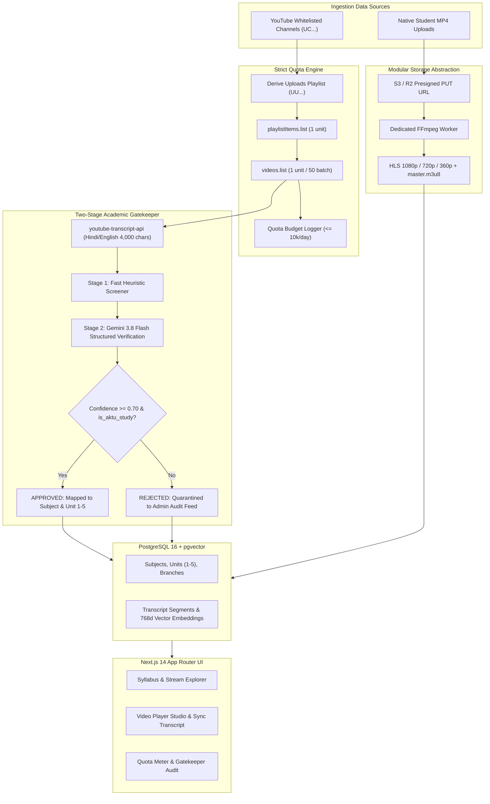

# AKTU Stream AI

An enterprise-grade, quota-conscious educational streaming platform specialized for the **Dr. A.P.J. Abdul Kalam Technical University (AKTU)** engineering curriculum and foundational AI/ML study tracks.

---

## Documentation Index

- **[PRD.md](file:///d:/Github%20projects/aktu-stream-ai/PRD.md):** Complete Product Requirements Document detailing personas, core problems, and requirements.
- **[ARCHITECTURE.md](file:///d:/Github%20projects/aktu-stream-ai/ARCHITECTURE.md):** High-Level Architecture Flow Diagrams, ERD models, directory map, and runtime specifications.
- **[DECISIONS.md](file:///d:/Github%20projects/aktu-stream-ai/DECISIONS.md):** Detailed Technical Decisions, Library Justifications & Alternatives Evaluated.

---

## Key Platform Capabilities

1. **Strict Quota Budgeting (Zero `search.list`)**:
   - YouTube Data API v3 `search.list` is permanently forbidden (100 units/call saved).
   - Video ingestion operates exclusively on whitelisted channel uploads playlists (`UU...` dynamically derived from `UC...`), executing queries via `playlistItems.list` (1 unit/call) and batched `videos.list` (1 unit per 50 videos).
   - Real-time quota tracking ensures the platform never breaches the 10,000 units/day budget.

2. **Two-Stage Content Gatekeeper AI**:
   - **Stage 1 (Fast Heuristic Screener)**: Pre-filters gaming, entertainment, clickbait, and non-academic content via keyword and metadata scanning.
   - **Stage 2 (Deep Academic Verification)**: Passes cleaned Hindi/English transcripts (first 4,000 characters) and metadata to **Gemini 3.8 Flash** with Pydantic structured output.
   - **Threshold Enforcement**: Videos failing `is_aktu_or_ai_study` or returning a confidence score under **0.70** are automatically quarantined into a rejection audit feed and excluded from student interfaces.

3. **Modular Storage & HLS Multi-Bitrate Pipeline**:
   - Zero video bytes pass through or reside inside web server memory.
   - Native student MP4 uploads stream directly to **AWS S3 / Cloudflare R2** via presigned URLs.
   - Background worker processes videos into adaptive bitrate HLS streams (**1080p, 720p, 360p**) with a unified `master.m3u8` playlist.

4. **Curriculum Strictness & Zero Hallucination**:
   - Strictly enforces official AKTU subject codes (e.g., `BCS301`, `BCS501`, `BAS101`) or the reserved tag `AI_GENERAL`.
   - Database constraint guarantees unit interval: `1 <= unit_number <= 5`.

5. **Synchronized Video Player Studio**:
   - Enterprise video player supporting both HLS `.m3u8` streams and YouTube embeds.
   - Synchronized transcript panel highlights spoken phrases in real time.
   - Click-to-seek jump points allow students to click any transcript line and instantly jump the video player.

---

## System Architecture



---

## Directory Structure

```
aktu-stream-ai/
├── backend/
│   ├── app/
│   │   ├── api/v1/
│   │   │   ├── api.py           # Master router
│   │   │   ├── subjects.py      # Branches, subjects, 5 units
│   │   │   ├── videos.py        # Video streams, details, transcript sync
│   │   │   ├── ingestion.py     # Channel whitelist, trigger, quota meter
│   │   │   ├── upload.py        # S3 presigned URLs, transcode polling
│   │   │   ├── search.py        # pgvector transcript semantic search
│   │   │   └── stats.py         # System health and counts
│   │   ├── core/
│   │   │   ├── config.py        # Pydantic Settings
│   │   │   └── database.py      # Async SQLAlchemy engine & sessionmaker
│   │   ├── models/
│   │   │   └── models.py        # Schema strict models, CheckConstraints
│   │   ├── schemas/
│   │   │   └── schemas.py       # Pydantic v2 data transfer schemas
│   │   ├── services/
│   │   │   ├── classifier_service.py # Two-Stage AI Classifier
│   │   │   ├── youtube_service.py    # Strict quota UU query engine
│   │   │   ├── transcript_service.py # Hindi/English subtitle parser
│   │   │   ├── storage_service.py    # S3/R2 presigned upload service
│   │   │   ├── transcoder_service.py # FFmpeg multi-bitrate HLS pipeline
│   │   │   ├── taxonomy_service.py   # Official AKTU curriculum seed
│   │   │   └── vector_service.py     # pgvector semantic transcript search
│   │   ├── workers/
│   │   │   └── tasks.py         # Ingestion and HLS transcode background tasks
│   │   └── main.py              # FastAPI app with lifecycle hooks
│   ├── tests/
│   │   ├── test_youtube_quota.py      # Zero search.list & UU verification
│   │   ├── test_classifier.py         # Two-stage gatekeeper & 0.70 threshold
│   │   ├── test_schema_constraints.py # 1 <= unit_number <= 5 checks
│   │   ├── test_storage_hls.py        # Presigned upload & master manifest
│   │   └── test_api.py                # Integration tests
│   ├── Dockerfile
│   ├── Dockerfile.worker
│   ├── pyproject.toml
│   └── requirements.txt
├── frontend/
│   ├── src/
│   │   ├── app/
│   │   │   ├── layout.tsx             # Root layout with dark theme
│   │   │   ├── page.tsx               # Academic matrix & stream feed
│   │   │   ├── subjects/page.tsx      # Curriculum directory
│   │   │   ├── subjects/[code]/page.tsx # 5 Units tabs & unit video feeds
│   │   │   ├── watch/[id]/page.tsx    # Player studio with sync transcript
│   │   │   ├── upload/page.tsx        # Direct presigned MP4 uploader
│   │   │   ├── admin/ingestion/page.tsx # Quota meter & rejection audit
│   │   │   └── search/page.tsx        # Semantic transcript search
│   │   ├── components/
│   │   │   ├── layout/Navbar.tsx
│   │   │   ├── player/VideoPlayer.tsx # HLS & YouTube player with seek
│   │   │   └── video/VideoCard.tsx    # Card with unit and confidence badges
│   │   └── lib/
│   │       ├── api.ts                 # Type-safe API client
│   │       └── types.ts               # Shared TypeScript types
│   ├── package.json
│   ├── tsconfig.json
│   └── tailwind.config.ts
├── docker-compose.yml
├── .env.example
└── README.md
```

---

## Quickstart

### Prerequisites
- Python 3.12+
- Node.js 18+
- Docker & Docker Compose (optional for containerized deployment)

### 1. Environment Setup
```bash
cp .env.example .env
```
Populate your credentials in `.env`:
- `YOUTUBE_API_KEY`: Google Cloud YouTube Data API v3 key.
- `GEMINI_API_KEY`: Google Gemini API key for academic classification and pgvector embeddings.

### 2. Running with Docker Compose
```bash
docker compose up -d --build
```
This launches:
- **FastAPI Backend**: `http://localhost:8000` (Docs: `http://localhost:8000/docs`)
- **Next.js Frontend**: `http://localhost:3000`
- **PostgreSQL 16 + pgvector**: `localhost:5432`
- **Redis 7**: `localhost:6379`
- **MinIO S3**: `http://localhost:9000` (Console: `http://localhost:9001`)

### 3. Running Locally for Development

#### Backend
```bash
cd backend
python -m venv .venv
source .venv/bin/activate  # Or on Windows: .venv\Scripts\activate
pip install -r requirements.txt
uvicorn app.main:app --reload --port 8000
```

#### Running Tests
```bash
cd backend
python -m pytest tests/ -v
```

#### Frontend
```bash
cd frontend
npm install
npm run dev
```
Open `http://localhost:3000` in your browser.

---

## Classification Schema Output Example

When a candidate video is ingested, the Stage-2 AI Classifier evaluates its metadata and transcript to output:

```json
{
  "is_aktu_or_ai_study": true,
  "subject_code": "BCS501",
  "unit_number": 2,
  "confidence": 0.96,
  "summary": "Covers relational algebra, tuple relational calculus, and SQL join queries for AKTU Unit 2 DBMS.",
  "rejection_reason": null,
  "topics_covered": [
    "Relational Algebra",
    "Tuple Relational Calculus",
    "SQL Joins",
    "Integrity Constraints"
  ]
}
```

If rejected:
```json
{
  "is_aktu_or_ai_study": false,
  "subject_code": "AI_GENERAL",
  "unit_number": 1,
  "confidence": 0.15,
  "summary": "Non-academic content: Matched non-academic indicator: 'gameplay'",
  "rejection_reason": "Matched non-academic indicator: 'gameplay'",
  "topics_covered": []
}
```
Rejected entries are logged to `/api/v1/ingestion/audit-log` and quarantined from student feeds.
